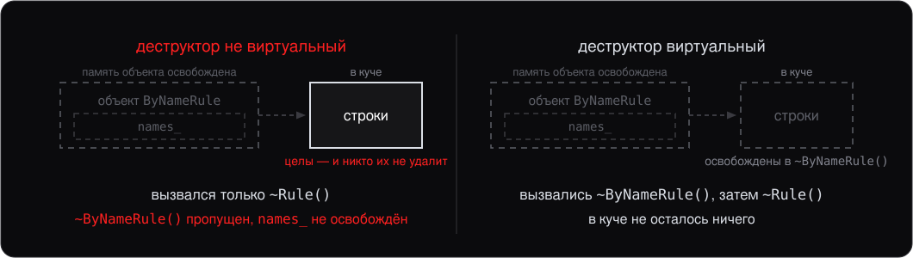
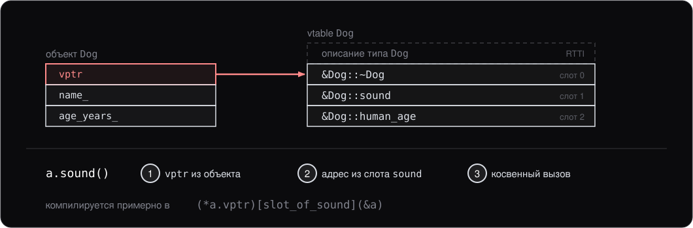
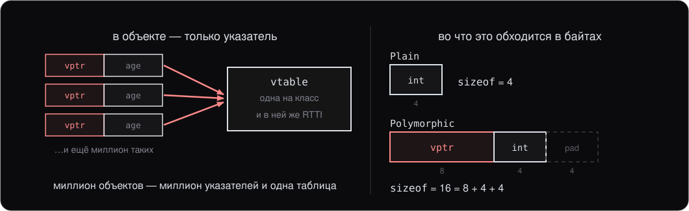
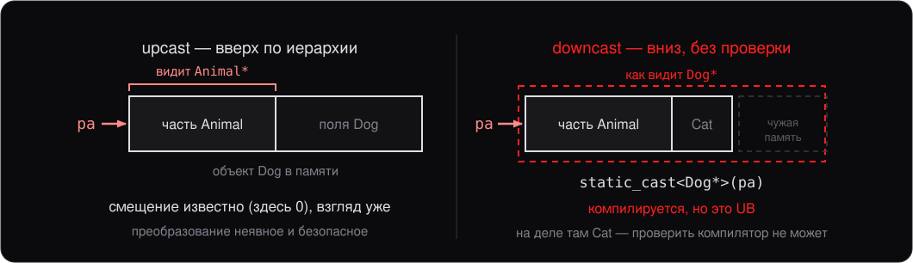

# Лекция 7. Полиморфизм и виртуальные функции

> Конспект к лекции для самостоятельного чтения. Слайды (`slides.md`) повторяют структуру, конспект подробнее объясняет «почему».

## 0. О чём эта лекция

Это вторая лекция про наследование, и она про то, ради чего наследование чаще всего и делается. На прошлой лекции мы научились писать «класс `Dog` наследуется от `Animal`», разобрали [layout](../glossary.md#layout) (размещение в памяти), [множественное наследование](../glossary.md#multiple-inheritance) (multiple inheritance) и [ромбовидную проблему](../glossary.md#diamond) (diamond problem), а в конце пришли к выводу, что полем вместо базы обойтись можно почти всегда. Главный случай, когда нельзя, — **полиморфизм**: работа с объектами разных классов через один общий интерфейс. Средствами лекции 6 его не построить, и лекция начинается с того, что именно ломается.

Сегодня мы:

- Поставим задачу — набор разных правил детекта в одном цикле — и увидим, почему наследование само по себе её не решает.
- Введём виртуальные функции — главный механизм полиморфизма в C++.
- Закроем три ловушки, которые появляются вместе с ним: опечатку в сигнатуре (`override`), базу без осмысленного поведения (абстрактные классы) и забытый виртуальный деструктор.
- Соберём устройство виртуальных функций — vtable — руками на обычном C++ и посчитаем, сколько оно стоит.
- Разберём касты в иерархии, `dynamic_cast` и RTTI.
- В конце — `enum class` как современная замена `enum`.

К концу лекции вы должны:

- Объяснять разницу между статическим и динамическим связыванием и писать иерархию с виртуальными функциями.
- Ставить `override` на каждое переопределение и понимать, от какой ошибки он защищает.
- Описывать интерфейс абстрактным классом и объяснять, почему у полиморфной базы деструктор обязан быть виртуальным.
- Рассказать, как устроены vtable и vptr, и оценить цену виртуального вызова.
- Выбирать между `static_cast` и `dynamic_cast` для downcast и объяснять, на чём работает `dynamic_cast`.

## 1. Разные правила в одном цикле

Система обнаружения атак устроена так: есть поток **событий** с машины (запустился процесс, открылся файл, установилось соединение) и есть набор **правил детектирования**, каждое из которых умеет сказать про событие «это подозрительно». Правила устроены по-разному: одно смотрит на имя процесса, другое — на цепочку родителей, третье — на частоту событий. Общего кода у них почти нет.

Событие для примера возьмём минимальное — в настоящем агенте полей больше, но для механики языка хватит одного:

```cpp
struct Event {
    std::string process{};    // имя запущенного процесса
};
```

Движок проверки хочется написать так:

```cpp
std::vector<std::unique_ptr<Rule>> rules;    // правила разных типов

void Check(const Event& e) {
    for (const auto& rule : rules) {
        if (rule->Matches(e)) std::print("детект: {}\n", e.process);
    }
}
```

От этого кода нужны два свойства. Во-первых, в одном контейнере лежат правила **разных типов**: вектор хранит указатели одного типа, а объекты за ними у каждого элемента свои. Во-вторых, `Check` не упоминает ни одного конкретного правила: новое правило — это новый класс плюс строка регистрации, а `Check` не меняется.

### Попытка средствами лекции 6

Общий тип для всех правил — база `Rule`, каждое правило — наследник:

```cpp
class Rule {
public:
    bool Matches(const Event&) const { return false; }
};

class ByNameRule : public Rule {
public:
    bool Matches(const Event& e) const { return e.process == "nc.exe"; }
};
```

Положить `ByNameRule` в вектор `unique_ptr<Rule>` можно: это тот же [upcast](../glossary.md#upcast-downcast), что на лекции 6 работал для обычных указателей. Программа компилируется. Приходит событие `nc.exe` — и детекта нет.

Причина в том, как компилятор выбирает функцию для `rule->Matches(e)`. Тип `rule` — указатель на `Rule`, и компилятор ищет `Matches` в классе `Rule`. Находит, вставляет прямой вызов `Rule::Matches` и больше к этой строке не возвращается. На объект он не смотрит и смотреть не может: что лежит в векторе, станет известно только во время выполнения. `ByNameRule::Matches` вызвалась бы, только если позвать её через указатель или ссылку на `ByNameRule`, — а такого типа в `Check` нет.


Слева — то, что получилось: функцию выбирает компилятор по типу указателя, и объект в выборе не участвует. Справа — то, что нужно: функцию выбирает сам объект. Наследование дало общий тип, но не общее **поведение** — для этого нужен ещё один механизм.

В коде этого раздела есть и вторая ошибка, менее заметная: при уничтожении вектора он вызывает [UB](../glossary.md#ub) (undefined behavior). Её разбирает раздел 5.

## 2. Виртуальные функции

Правая половина схемы получается одним словом в базе:

```cpp
class Rule {
public:
    virtual bool Matches(const Event&) const { return false; }
};

class ByNameRule : public Rule {
public:
    bool Matches(const Event& e) const { return e.process == "nc.exe"; }
};
```

Наследник не изменился, `Check` тоже. Теперь `rule->Matches(e)` для объекта `ByNameRule` вызывает `ByNameRule::Matches`, и детект есть.

`Rule::Matches` стала **[виртуальной функцией](../glossary.md#virtual-function)** (virtual function). Функция наследника с той же [сигнатурой](../glossary.md#signature) (signature) её **[переопределяет](../glossary.md#override)** (overriding) и сама становится виртуальной — повторять `virtual` в наследнике не нужно.

Два способа выбрать функцию называются так:

- **[Статическое связывание](../glossary.md#binding)** (static binding) — функцию выбирает компилятор по объявленному типу указателя или ссылки. Так вызываются все обычные методы.
- **Динамическое связывание** (dynamic binding) — функцию выбирает программа во время выполнения по настоящему типу объекта. Так вызываются виртуальные.

Одна и та же строка `rule->Matches(e)` вызывает разные функции для разных объектов — это и есть **полиморфизм**.

### Только через указатель или ссылку

Динамическое связывание работает, когда объект доступен через указатель или ссылку на базу:

```cpp
ByNameRule by_name;

Rule* p = &by_name;
p->Matches(e);        // ByNameRule::Matches

Rule& r = by_name;
r.Matches(e);         // ByNameRule::Matches

Rule copy = by_name;  // срезка
copy.Matches(e);      // Rule::Matches
```

Третий случай — **[срезка](../glossary.md#slicing)** (object slicing) с лекции 6: при копировании в объект `Rule` от наследника остаётся только базовая часть. `copy` — настоящий `Rule`, и вызывать у него нечего, кроме `Rule::Matches`. Поэтому полиморфные объекты хранят и передают через указатели и ссылки — как вектор `unique_ptr<Rule>` из раздела 1.

Откуда программа во время выполнения знает тип объекта — вопрос раздела 6. Там этот механизм собирается руками, без единого `virtual`.

## 3. `override` и `final`

### Опечатка в сигнатуре

Переопределение получается только при **точном** совпадении сигнатуры, включая `const` у метода. Вот наследник, в котором `const` забыт:

```cpp
class ByNameRule : public Rule {
public:
    bool Matches(const Event& e) { return e.process == "nc.exe"; }
};
```

Это уже **другая** функция: её сигнатура не совпадает с `Rule::Matches`, переопределения нет. Новая функция не заменяет виртуальную, а прячет её имя в `ByNameRule`. Программа компилируется, `Check` вызывает `Rule::Matches`, детектов снова нет — та же ошибка, что в разделе 1, но теперь при написанном `virtual`. Так же тихо ломает переопределение опечатка в имени (`Match` вместо `Matches`) или другой тип параметра.

### `override`

`override` — идентификатор с особым смыслом (identifier with special meaning; C++11), которым наследник обещает компилятору: «это переопределение». Если обещание не выполняется — [CE](../glossary.md#ce) (compilation error):

```cpp
class ByNameRule : public Rule {
public:
    bool Matches(const Event& e) const override { /* ... */ }  // ok
    bool Matches(const Event& e) override { /* ... */ }        // CE: нет const
    bool Match(const Event& e) const override { /* ... */ }    // CE: опечатка
};
```

`override` не меняет смысла программы: с правильной сигнатурой функция переопределяет виртуальную и без него. Он превращает тихий баг во время выполнения в ошибку компиляции.

**Привычка профессионального C++:** `override` на каждом переопределении. Это бесплатная защита.

### `final`

`final` запрещает переопределять функцию дальше или наследоваться от класса:

```cpp
class ByNameRule : public Rule {
public:
    bool Matches(const Event& e) const final { /* ... */ }  // дальше не переопределить
};

class ByHashRule final : public Rule { /* ... */ };         // наследников не будет
```

Применяется редко — чтобы зафиксировать архитектуру и иногда разрешить компилятору **[devirtualization](../glossary.md#devirtualization)** вызова: если переопределений больше быть не может, функцию можно вызвать напрямую (раздел 6).

## 4. Абстрактные классы

### База без поведения

Какое тело написать у `Rule::Matches`? Каждое конкретное правило знает, что искать: `ByNameRule` сравнивает имя процесса, `ByRateRule` считает события. А «правило вообще» не знает ничего — честного ответа у базы нет. В разделах 1–3 там стоял `false`, но не потому, что база что-то проверила и ничего не нашла, а только чтобы у функции было тело и код компилировался.

Беда в том, что этот `false` неотличим от настоящего ответа «проверено, всё чисто». Отсюда две ошибки, которые компилятор пропускает молча:

```cpp
Rule r;                       // создаётся, хотя это не правило
r.Matches(e);                 // false: «чисто», хотя никто не проверял

class ByPathRule : public Rule {};   // Matches забыли переопределить
```

Первая — объект `Rule`, который выглядит как правило, а не проверяет ничего. Вторая опаснее: `ByPathRule` попадает в вектор правил, на каждое событие отвечает `false` из базы, и по выводу программы не видно, что одно из правил не работает. Так же ведёт себя наследник, ошибившийся в сигнатуре без `override` (раздел 3).

Обе ошибки хочется превратить в ошибки компиляции.

### Чисто виртуальная функция

Нужен способ сказать: «реализации в базе нет, и никакого `false` вместо неё тоже нет — наследник обязан её дать». Это **[чисто виртуальная функция](../glossary.md#pure-virtual)** (pure virtual function):

```cpp
class Rule {
public:
    virtual bool Matches(const Event& e) const = 0;
};
```

Класс хотя бы с одной чисто виртуальной функцией называется **[абстрактным классом](../glossary.md#abstract-class)** (abstract class), и создать его объект нельзя:

```cpp
Rule r;                                      // CE: Rule — абстрактный
auto p = std::make_unique<Rule>();           // CE
auto q = std::make_unique<ByNameRule>();     // ok
```

Наследник, который переопределил все чисто виртуальные функции, — обычный, конкретный класс. Наследник, который пропустил хотя бы одну, сам остаётся абстрактным, и создать его объект тоже нельзя. Обе ошибки из начала раздела стали ошибками компиляции: `Rule r;` не компилируется, а `ByPathRule` без `Matches` сам абстрактный, и положить его в вектор правил нельзя.

### Интерфейс

Абстрактный класс без данных — **интерфейс**: описание контракта без реализации. Аналог `interface` в Java или класса с `ABC` в Python. Конкретное правило реализует контракт:

```cpp
class ByNameRule : public Rule {
public:
    ByNameRule(const std::string& name) : name_(name) {}
    bool Matches(const Event& e) const override {
        return e.process == name_;
    }

private:
    std::string name_{};
};
```

`Check` из раздела 1 знает только `Rule` — и работает с любым наследником, в том числе написанным через год. Этого и добиваются, когда говорят «программировать против интерфейса»: точки расширения находятся там, где код добавляется, а не там, где он правится.

Если показалось, что то же самое можно сделать шаблонами — верно, часто можно, и на лекциях 8–9 мы увидим, как. Разница в моменте выбора: шаблон требует знать набор правил на этапе компиляции, виртуальные функции позволяют собрать его **во время выполнения** — например, прочитав список включённых правил из конфигурации. Когда состав известен только в рантайме, альтернатив виртуальности практически нет.

### Чисто виртуальные с реализацией

Допустимо дать чисто виртуальной функции **тело** — отдельно от объявления:

```cpp
class Rule {
public:
    virtual bool Matches(const Event& e) const = 0;
};

bool Rule::Matches(const Event&) const { return false; }   // ok, Rule всё равно абстрактный
```

Класс по-прежнему абстрактный, и наследник по-прежнему обязан переопределить функцию. Зато в своей реализации он может явно вызвать базовую — `Rule::Matches(e)`. Применение редкое: дать наследникам поведение по умолчанию, но потребовать, чтобы каждый явно решил, пользоваться ли им.

## 5. Виртуальный деструктор

### Ошибка в коде раздела 1

Пусть правило ищет не одно имя, а несколько, и хранит их в векторе:

```cpp
class ByNameRule : public Rule {
public:
    bool Matches(const Event& e) const override;

private:
    std::vector<std::string> names_{};   // буфер в куче
};

std::vector<std::unique_ptr<Rule>> rules;
rules.push_back(std::make_unique<ByNameRule>());
```

Когда вектор `rules` уничтожается, каждый `unique_ptr<Rule>` делает `delete` своего указателя — а указатель у него типа `Rule*`. Дальше то же, что в разделе 1 с `Matches`: деструктор `Rule` не виртуальный, компилятор выбирает его статически по типу указателя и вызывает только `~Rule()`. Деструктор `~ByNameRule()` не вызывается, а с ним и деструктор `names_`.

Стандарт называет `delete` объекта наследника через указатель на базу без виртуального деструктора UB. На практике обычно получается [утечка](../glossary.md#memory-leak) (memory leak): всё, что принадлежало наследнику, остаётся в [куче](../glossary.md#heap) (heap) без [владельца](../glossary.md#ownership) (ownership). Для правила, которое живёт до конца программы, это незаметно; для агента, который перезагружает набор правил по команде, это память, которая растёт с каждой перезагрузкой.

### Решение

```cpp
class Rule {
public:
    virtual ~Rule() = default;
    virtual bool Matches(const Event& e) const = 0;
};
```

Деструктор, как и любая виртуальная функция, теперь выбирается по объекту: `delete` через `Rule*` вызывает `~ByNameRule()`, а тот по обычным правилам лекции 6 — `~Rule()`. Деструктор наследника виртуален автоматически; если он написан руками, на нём тоже можно поставить `override`.



### Жёсткое правило

**Если в классе есть хотя бы одна виртуальная функция — деструктор должен быть виртуальным.** Без исключений.

Обычно это одна строка `virtual ~Base() = default;`: базе нечего освобождать, тело деструктора генерирует компилятор, нужно только пометить его виртуальным.

Если класс **не предназначен** для полиморфного использования, деструктор остаётся невиртуальным. Это нормальный случай для большинства классов, которые «просто хранят данные».

## 6. Таблица вызовов руками

`virtual` — не магия компилятора и не отдельная подсистема рантайма. Механизм, который за ним стоит, целиком выражается на обычном C++: структура с указателями на функции плюс указатель на такую структуру в самом объекте. Соберём его руками — получится самодельная [vtable](../glossary.md#vtable) (по-русски — таблица виртуальных функций), и после этого поведение виртуальных функций перестаёт быть чем-то, что надо запоминать.

Указатели на функции разбирались на лекции 3, здесь они основной инструмент. Пример — нейтральный, животные с двумя операциями: правила из прошлых разделов дали бы ту же картину, но с лишними деталями.

### Шаг 1. Таблица методов

Опишем «поведение» из двух операций — `sound` и `human_age`. Таблица методов — наш аналог vtable — это обычная структура, все поля которой являются указателями на реализации:

```cpp
struct Animal;                      // нужен для сигнатур в таблице

using AnimalSoundFn = const char*(*)(const Animal* self);
using AnimalAgeFn   = int(*)(const Animal* self);

struct AnimalOps {                  // таблица методов
    AnimalSoundFn sound{};
    AnimalAgeFn   human_age{};
};

struct Animal {
    const AnimalOps* ops{};         // первое поле — указатель на таблицу
    const char* name{};
    int age_years{};
};
```

Тип указателя на функцию читается тяжело: `const char* (*sound)(const Animal*)` — имя поля оказывается в середине объявления. Поэтому типы указателей сначала получают имена через `using`, и поле таблицы объявляется так же, как любое другое: тип, затем имя.

Пустые `{}` у полей — привычка, а не требование примера: поле, инициализированное в объявлении, не может остаться мусором, даже если объект создали, не указав его значение. Указатель тогда равен `nullptr`, число — нулю.

Первым полем объекта лежит указатель на таблицу, дальше — обычные данные. Порядок здесь не случаен: он позволяет добраться до таблицы, зная только адрес объекта.

### Шаг 2. Две реализации

```cpp
const char* dog_sound(const Animal*) { return "woof"; }
int dog_human_age(const Animal* self) { return self->age_years * 7; }
constexpr AnimalOps kDogOps{dog_sound, dog_human_age};

const char* bird_sound(const Animal*) { return "tweet"; }
int bird_human_age(const Animal* self) { return self->age_years * 5; }
constexpr AnimalOps kBirdOps{bird_sound, bird_human_age};
```

Сколько бы собак вы ни создали, таблица `kDogOps` останется одна.

Параметр `self` — это `this`, написанный руками: через него реализация добирается до полей объекта (`dog_human_age` им пользуется). Там, где данные объекта не нужны, имя параметра можно опустить — как в `dog_sound`.

### Шаг 3. Вызов через таблицу

```cpp
void describe(const Animal* a) {
    std::print("{}: {}, по-человечески {}\n",
               a->name, a->ops->sound(a), a->ops->human_age(a));
}

int main() {
    Animal dog{&kDogOps, "Sharik", 3};
    Animal bird{&kBirdOps, "Kesha", 3};
    describe(&dog);      // Sharik: woof, по-человечески 21
    describe(&bird);     // Kesha: tweet, по-человечески 15
}
```


`describe` не знает, собака перед ней или птица, и не содержит ни одной проверки типа. Она делает три шага: берёт из объекта указатель на таблицу, из таблицы — указатель на функцию, вызывает его и передаёт сам объект. Это уже полноценная **[динамическая диспетчеризация](../glossary.md#dynamic-dispatch)** (dynamic dispatch), и слова `virtual` в коде нет.

### То же самое на `virtual`

```cpp
class Animal {
public:
    Animal(const char* name, int age) : name_(name), age_years_(age) {}
    virtual ~Animal() = default;
    virtual const char* sound() const = 0;
    virtual int human_age() const = 0;
    const char* name() const { return name_; }

protected:
    const char* name_{};
    int age_years_{};
};

class Dog : public Animal {
public:
    Dog(const char* name, int age) : Animal(name, age) {}
    const char* sound() const override { return "woof"; }
    int human_age() const override { return age_years_ * 7; }
};

class Bird : public Animal {
public:
    Bird(const char* name, int age) : Animal(name, age) {}
    const char* sound() const override { return "tweet"; }
    int human_age() const override { return age_years_ * 5; }
};

void describe(const Animal& a) {
    std::print("{}: {}, по-человечески {}\n", a.name(), a.sound(), a.human_age());
}
```

Вывод у обеих программ одинаковый. Разница только в том, кто пишет таблицы и обращения к ним.

**Правило:** `virtual` — это ровно та конструкция, которую мы собрали руками, только таблицы генерирует компилятор, а `self` он подставляет сам как `this`.

### vtable и vptr

Терминология: таблицу, которую компилятор создаёт для каждого полиморфного класса, называют **vtable**; скрытое поле-указатель на неё внутри объекта — **vptr**. В ручной версии это `AnimalOps` и `Animal::ops`.



Те же три шага — та же динамическая диспетчеризация, что и в ручной версии; [косвенный вызов](../glossary.md#indirect-call) (indirect call) остаётся ровно один.

Отличия настоящей vtable от нашей непринципиальны: компилятор сам нумерует слоты и сам заполняет `vptr` при создании объекта. И кладёт рядом со слотами то, чего в ручной версии нет, — описание типа класса. Это [RTTI](../glossary.md#rtti) (run-time type information), на нём работают `dynamic_cast` и `typeid` (раздел 7).

### Сколько это стоит: `sizeof`

```cpp
struct Plain {
    int age_years{};
    void sound() const {}
};

struct Polymorphic {
    int age_years{};
    virtual void sound() const {}
    virtual ~Polymorphic() = default;
};

std::print("{} {}\n", sizeof(Plain), sizeof(Polymorphic));   // 4 16
```

`Plain` — четыре байта, ровно одно поле: обычные методы места в объекте не занимают. У `Polymorphic` к полю добавляются восемь байт `vptr` и [padding](../glossary.md#padding) до [выравнивания](../glossary.md#alignment) (alignment) в 8 — правила выравнивания с лекции 6.



Ключевое здесь — **таблица одна на класс, а в объекте только указатель на неё**. Добавьте в `Polymorphic` ещё девять виртуальных функций: вырастет таблица, а `sizeof` останется 16. Описание типа для RTTI тоже живёт в таблице, поэтому объект оно не увеличивает: путь к нему — тот же `vptr`.

### Цена вызова

- **Память:** +8 байт на объект на 64-битной системе — сам `vptr`. К ним может добавиться padding: `vptr` выравнивается по 8, и объект целиком тоже, поэтому `Polymorphic` с одним `int` занимает 16 байт, а не 12, — четыре из них пустые. Сколько добавит padding, зависит от остальных полей: у класса с двумя `int` поля займут ровно 8 байт после `vptr`, и пустого места не будет. Для класса с парой `int` это удвоение размера (с 8 до 16 байт), для класса на сотню байт — незаметно.
- **Время:** перед вызовом адрес функции читается из таблицы — одно лишнее чтение памяти. Процессор обычно угадывает, куда пойдёт такой вызов, так что сам вызов дёшев.
- **[Встраивание](../glossary.md#inlining) (inlining):** главная потеря. Компилятор не знает, какая функция вызовется, и не может подставить её тело на место вызова. А встраивание — это не только сэкономленный вызов: после подстановки компилятор видит код функции вместе с окружающим и упрощает их вместе — вычисляет выражения заранее ([свёртка констант](../glossary.md#constant-folding), constant folding), выбрасывает проверки, которые заведомо выполняются, обрабатывает цикл сразу по нескольку элементов ([векторизация](../glossary.md#vectorization), vectorization). Виртуальный вызов закрывает все эти возможности разом.

**Подвох:** «виртуальный вызов медленный» — утверждение не про сам вызов, а про барьер для оптимизаций вокруг него. Заметно это в горячем цикле на миллионы вызовов; в остальном коде цена `virtual` теряется.

Даже с учётом барьера это **намного дешевле**, чем в Java или Python, где виртуально почти всё. В C++ виртуальность только там, где явно написано `virtual`.

### Devirtualization

Если компилятор может доказать реальный тип объекта, он заменяет вызов через таблицу прямым — это **devirtualization**:

```cpp
Dog d{"Sharik", 3};
d.sound();          // тип известен точно → прямой вызов, можно встроить
```

Помогает `final` (раздел 3) и создание объекта рядом с местом вызова. Но как только объект приходит по `Animal&` из другой [единицы трансляции](../glossary.md#translation-unit) (translation unit), доказывать нечего, и вызов остаётся косвенным. Полагаться на devirtualization в дизайне не стоит: это оптимизация, а не гарантия.

## 7. Касты в иерархии и RTTI

### Upcast

На лекции 6 мы видели [upcast](../glossary.md#upcast-downcast) — приведение указателя или ссылки к базовому типу:

```cpp
class Animal { /* ... */ };
class Dog : public Animal { /* ... */ };

Dog d;
Animal* pa = &d;     // upcast, неявный
Animal& ra = d;      // upcast, неявный
```

Это работает, потому что `Dog` **является** `Animal`: это [подтипизация](../glossary.md#subtyping) (subtyping). Внутри объекта `Dog` лежит [подобъект](../glossary.md#subobject) (subobject) `Animal`, и по какому смещению он лежит, компилятор знает из определения `Dog`: при преобразовании он сам прибавляет это смещение к адресу. Здесь оно нулевое и адрес не меняется, но это частный случай, а не причина: на лекции 6 при множественном наследовании upcast ко второй базе сдвигал указатель. Причина в том, что смещение известно на этапе компиляции.

Поэтому upcast — **безопасное** [неявное преобразование](../glossary.md#implicit-conversion) (implicit conversion), явный [каст](../glossary.md#cast) (cast) для него не нужен. Весь полиморфизм этой лекции на нём и держится: в вектор `unique_ptr<Rule>` правила попадают именно upcast'ом.

### Downcast

Обратное приведение — от базы к наследнику — компилятор неявно **не** делает:

```cpp
Animal* pa = get_some_animal();
Dog* pd = pa;                          // CE: неявного преобразования Animal* → Dog* нет
Dog* pd = static_cast<Dog*>(pa);       // компилируется, но опасно
```

Смещение компилятор знает и здесь: `static_cast` вычтет его так же, как upcast прибавлял. Не знает он другого — **действительно ли** `pa` указывает на `Dog`, и на этапе компиляции проверить это нельзя. Если там `Cat`, любая операция через `pd` — UB.



`static_cast` для downcast уместен, только если вы **уверены**, что объект действительно того типа. Иначе нужна проверка во время выполнения.

### `dynamic_cast`

`dynamic_cast` — единственный **безопасный** downcast. Он проверяет настоящий тип объекта во время выполнения:

```cpp
Animal* a = get_some_animal();

if (Dog* d = dynamic_cast<Dog*>(a)) {
    d->bark();                       // ok, это действительно Dog или его наследник
} else {
    /* a указывает не на Dog */
}
```

Если `a` указывает на `Dog` (или на наследника `Dog`) — `dynamic_cast` возвращает указатель на него. Иначе — `nullptr`, и результат обязательно проверяется.

Для **ссылок** вернуть «ничего» нельзя — ссылки не бывают пустыми, — поэтому `dynamic_cast` **бросает** `std::bad_cast`:

```cpp
try {
    Dog& d = dynamic_cast<Dog&>(*a);
    d.bark();
} catch (const std::bad_cast&) {
    /* a — не Dog */
}
```

### RTTI

Откуда `dynamic_cast` знает тип объекта? Из RTTI — описания класса, которое компилятор генерирует для каждого полиморфного типа и кладёт рядом с его vtable (раздел 6). У объекта есть `vptr`, у таблицы — описание типа, и по нему `dynamic_cast` проверяет, является ли объект `Dog` или его наследником.

До этого описания можно добраться и напрямую, оператором `typeid` из заголовка `<typeinfo>`:

```cpp
if (typeid(*a) == typeid(Dog)) { /* ровно Dog, не наследник */ }
std::print("{}\n", typeid(*a).name());   // в GCC: "3Dog"
```

`typeid` от полиморфного объекта даёт его настоящий тип, и сравнение отвечает на вопрос «ровно этот класс» — в отличие от `dynamic_cast`, которому подходит и наследник. Строка из `name()` — [implementation-defined](../glossary.md#implementation-defined): GCC и Clang печатают внутреннее имя типа, MSVC — читаемое. Для логики программы на неё не опираются.

Из устройства RTTI следуют три вещи:

- **Только полиморфные классы.** Без виртуальных функций нет vtable и хранить описание негде: downcast через `dynamic_cast` для такого класса — CE, а `typeid` выдаёт объявленный тип выражения, а не настоящий тип объекта.
- **Объект не растёт.** Описание одно на класс и лежит рядом с таблицей; в `sizeof` из раздела 6 его нет.
- **RTTI можно выключить** — ключом компилятора `-fno-rtti`. Так иногда собирают код, где важен размер бинарника; `dynamic_cast` и `typeid` там не работают.

### Когда использовать

В **хорошо спроектированном** коде `dynamic_cast` встречается **редко**. Обычно вместо «проверим, что это `Dog`, и вызовем `bark`» правильнее иметь виртуальную функцию `sound()`, которая для `Dog` делает нужное, — и не приводить тип вообще.

`dynamic_cast` уместен, когда:

- Библиотека отдаёт объект базовым типом, а работать нужно с конкретным.
- У одного наследника есть операция, которой нет и не должно быть в общем интерфейсе.

**Правило:** если в коде много `dynamic_cast` — дизайн стоит пересмотреть. Скорее всего, цепочку проверок типа можно заменить одной виртуальной функцией.

## 8. `enum` и `enum class`

В заключение лекции — небольшая, но важная тема.

### Классический `enum` (наследие C)

```cpp
enum Color { Red, Green, Blue };

Color c = Red;
int x = Red;          // ok: неявно преобразуется в int
```

Три проблемы:

1. **Имена попадают в окружающую [область видимости](../glossary.md#scope) (scope).** `Red`, `Green`, `Blue` теперь — глобальные имена. Если в другом `enum` тоже есть `Red` — конфликт имён.
2. **Неявное преобразование в `int`.** `Color` смешивается с числами, потеря типобезопасности.
3. **Размер не контролируется.** Компилятор выбирает размер сам, между `int` и достаточным, чтобы вместить все значения.

### `enum class` (C++11)

```cpp
enum class Color { Red, Green, Blue };

Color c = Color::Red;
int x = Color::Red;            // CE: no implicit conversion
int y = static_cast<int>(Color::Red);    // ok, явно
```

Преимущества:

- **Scoped.** Обращение `Color::Red` — имена не загрязняют окружающую область видимости. Отсюда и название — [scoped enumeration](../glossary.md#scoped-enum).
- **Строгая типизация.** Не преобразуется неявно в `int`. Нельзя случайно подставить `Color` туда, где ждут `int`.
- **[Underlying type](../glossary.md#underlying-type) (по-русски — базовый тип перечисления) контролируется:** `enum class Color : uint8_t { ... }` — задаём, какой именно тип под капотом.

**Правило в новом коде:** используйте `enum class`, не `enum`. Старый `enum` оставляйте только если этого требует совместимость с C-API. Преимуществ у обычного `enum` перед `enum class` практически нет.

## Итоги

- **Наследование даёт общий тип, но не общее поведение:** без `virtual` вызов через указатель на базу выбирается по типу указателя, и все правила в цикле зовут `Rule::Matches`.
- **Виртуальные функции** включают динамическое связывание: функция выбирается по настоящему типу объекта. Работает через указатель или ссылку, по значению — срезка.
- **`override`** превращает опечатку в сигнатуре из тихого бага в CE — писать на каждом переопределении. `final` запрещает дальнейшее переопределение.
- **Чисто виртуальные** (`= 0`) делают класс **абстрактным**: его нельзя создать, а наследник обязан дать реализацию. Абстрактный класс без данных — интерфейс.
- **Виртуальный деструктор обязателен**, если в классе есть любая виртуальная функция. Без него `delete` через указатель на базу — UB.
- **vtable + vptr** — механизм, который собирается руками на обычном C++: структура с указателями на функции плюс указатель на неё первым полем объекта. `virtual` делает ровно это.
- **Таблица одна на класс**, в объекте только указатель на неё: `sizeof` растёт на 8 байт независимо от числа виртуальных функций. Главная цена вызова — потеря встраивания.
- **Downcast** — через `dynamic_cast`, который работает на RTTI: описании типа рядом с vtable. Много `dynamic_cast` — признак, что дизайн стоит пересмотреть.
- **`enum class`** — единственная форма enum, которую стоит писать в новом коде.

## Что дальше

Следующая лекция — **шаблоны: введение**:

- Шаблонные функции и классы
- [Инстанцирование](../glossary.md#instantiation) (instantiation), [двухфазный поиск имён](../glossary.md#two-phase) (two-phase name lookup)
- **[CTAD](../glossary.md#ctad)** (class template argument deduction) — [вывод аргументов](../glossary.md#deduction) шаблона класса из аргументов конструктора (C++17)
- [Перегрузка](../glossary.md#overload) (overloading) и [специализация](../glossary.md#specialization) (specialization) шаблонов
- [Non-type template parameters](../glossary.md#non-type-parameter)
- Базовые [type traits](../glossary.md#type-traits) (`is_same`, `remove_const`)
- [Зависимые имена](../glossary.md#dependent-name) (dependent names), `typename` и `template` disambiguators
