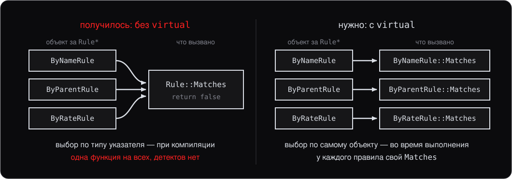

<style>
section {
    font-size: 25px;
}
</style>

<!-- _class: lead -->

# Лекция 7.

## Полиморфизм и виртуальные функции

---

# План

1. Разные правила в одном цикле
2. Виртуальные функции
3. `override` и `final`
4. Абстрактные классы
5. Виртуальный деструктор
6. Таблица вызовов руками
7. Касты в иерархии и RTTI
8. `enum` и `enum class`

---
<!-- header: 1. Разные правила в одном цикле -->

# 1. Разные правила в одном цикле

Движок проверяет каждое событие набором **правил детекта**: по имени процесса, по цепочке родителей, по частоте. Устроены правила по-разному.

Хочется так:

```cpp
std::vector<std::unique_ptr<Rule>> rules;    // правила разных типов

void Check(const Event& e) {
    for (const auto& rule : rules) {
        if (rule->Matches(e)) std::print("детект: {}\n", e.process);
    }
}
```

Новое правило — новый класс, а `Check` не меняется.

---

## Попытка средствами лекции 6

```cpp
struct Event {
    std::string process{};
};

class Rule {
public:
    bool Matches(const Event&) const { return false; }
};

class ByNameRule : public Rule {
public:
    bool Matches(const Event& e) const { return e.process == "nc.exe"; }
};
```

Компилируется. Событие `nc.exe` приходит — детекта нет: `rule->Matches(e)` вызывает `Rule::Matches`.

---

## Что получилось и что нужно



---
<!-- header: 2. Виртуальные функции -->

# 2. Виртуальные функции

Одно слово в базе делает `Matches` **виртуальной функцией** (virtual function):

```cpp
class Rule {
public:
    virtual bool Matches(const Event&) const { return false; }
};

class ByNameRule : public Rule {
public:
    bool Matches(const Event& e) const { return e.process == "nc.exe"; }
};
```

Теперь `rule->Matches(e)` для `ByNameRule` вызывает `ByNameRule::Matches` — детект есть.

---

## Статическое и динамическое связывание

- **Статическое связывание** (static binding) — функцию выбирает компилятор по типу указателя `Rule*`. Так вызываются обычные методы
- **Динамическое связывание** (dynamic binding) — функцию выбирает программа во время выполнения по самому объекту. Так вызываются виртуальные функции

Одна строка `rule->Matches(e)` вызывает разные функции для разных объектов — это и есть **полиморфизм**.

Как программа узнаёт тип объекта — раздел 6.

---

## Только через указатель или ссылку

```cpp
ByNameRule by_name;

Rule* p = &by_name;
p->Matches(e);        // ByNameRule::Matches

Rule& r = by_name;
r.Matches(e);         // ByNameRule::Matches

Rule copy = by_name;  // срезка (slicing), лекция 6
copy.Matches(e);      // Rule::Matches: в copy лежит только Rule
```

По значению полиморфизма нет: копия базы — это объект `Rule`, и ничего, кроме `Rule`, в нём не осталось.

---
<!-- header: 3. override / final -->

# 3. `override` и `final`

Переопределение (overriding) получается только при **точном** совпадении сигнатуры (signature):

```cpp
class ByNameRule : public Rule {
public:
    bool Matches(const Event& e) { return e.process == "nc.exe"; }
};
```

Забыт `const` — и это уже **другая** функция. Она не переопределяет `Rule::Matches`, а прячет её рядом. Программа компилируется, детектов снова нет.

---

## `override`

```cpp
class ByNameRule : public Rule {
public:
    bool Matches(const Event& e) const override { /* ... */ }  // ok
    bool Matches(const Event& e) override { /* ... */ }        // CE
    bool Match(const Event& e) const override { /* ... */ }    // CE
};
```

`override` — обещание компилятору «это переопределение». Не совпала сигнатура или имя — ошибка компиляции, а не тихий баг.

**Привычка профессионального C++:** `override` на каждом переопределении.

---

## `final`

`final` запрещает переопределять дальше или наследоваться:

```cpp
class ByNameRule : public Rule {
public:
    bool Matches(const Event& e) const final { /* ... */ }
};

class ByHashRule final : public Rule { /* ... */ };  // наследников не будет
```

Применяется редко: чтобы зафиксировать архитектуру или подсказать компилятору, что других переопределений нет (раздел 6, devirtualization).

---
<!-- header: 4. Абстрактные классы -->

# 4. Абстрактные классы

Какое тело написать у `Rule::Matches`? «Правило вообще» не знает, что искать, — честного ответа у базы нет. `false` вписан, только чтобы код компилировался, и он читается как «проверено, всё чисто»:

```cpp
Rule r;                       // создаётся, хотя это не правило
r.Matches(e);                 // false: «чисто», хотя никто не проверял

class ByPathRule : public Rule {};   // Matches забыли переопределить
// в векторе правил отвечает false на любое событие
```

Обе ошибки компилируются молча. Запретить их — задача **абстрактного класса** (abstract class): базы, у которой реализации нет.

---

## Чисто виртуальная функция

```cpp
class Rule {
public:
    virtual bool Matches(const Event& e) const = 0;
};
```

`= 0` — **чисто виртуальная функция** (pure virtual function): реализации нет, наследник обязан её дать.

```cpp
Rule r;                                      // CE: Rule — абстрактный
auto p = std::make_unique<ByNameRule>();     // ok
```

Класс с чисто виртуальной функцией — **абстрактный**, объект его создать нельзя. Наследник, не переопределивший её, тоже абстрактный.

---

## Интерфейс

Абстрактный класс без данных — **интерфейс**: контракт без реализации. Аналог `interface` в Java и `ABC` в Python.

```cpp
class ByNameRule : public Rule {
public:
    ByNameRule(const std::string& name) : name_(name) {}
    bool Matches(const Event& e) const override {
        return e.process == name_;
    }

private:
    std::string name_{};
};
```

`Check` из раздела 1 знает только `Rule` — и работает с любым наследником.

---
<!-- header: 5. Виртуальный деструктор -->

# 5. Виртуальный деструктор

В коде раздела 1 есть UB. Пусть правило владеет списком имён:

```cpp
class ByNameRule : public Rule {
public:
    bool Matches(const Event& e) const override;

private:
    std::vector<std::string> names_{};   // буфер в куче
};

{
    std::vector<std::unique_ptr<Rule>> rules;
    rules.push_back(std::make_unique<ByNameRule>());
}   // delete через Rule* — деструктор выбран по типу указателя
```

Вызван только деструктор базы, деструктор наследника пропущен — это **UB**, на практике утечка памяти (memory leak): `names_` никто не освободит.

---

## Решение — `virtual`

```cpp
class Rule {
public:
    virtual ~Rule() = default;
    virtual bool Matches(const Event& e) const = 0;
};
```

Теперь `delete` через `Rule*` вызывает `~ByNameRule()`, затем `~Rule()`.

**Правило:** если в классе есть **любая** виртуальная функция — деструктор виртуальный. Без исключений.

---

## Что остаётся после `delete`


---
<!-- header: 6. Таблица вызовов руками -->

# 6. Таблица вызовов руками

`virtual` — не магия компилятора. Тот же механизм — vtable — собирается на обычном C++.

```cpp
struct Animal;                   // нужен для сигнатур в таблице

using AnimalSoundFn = const char*(*)(const Animal* self);
using AnimalAgeFn   = int(*)(const Animal* self);

struct AnimalOps {               // таблица методов
    AnimalSoundFn sound{};
    AnimalAgeFn   human_age{};
};

struct Animal {
    const AnimalOps* ops{};      // первое поле — указатель на таблицу
    const char* name{};
    int age_years{};
};
```

---

## Две реализации

```cpp
const char* dog_sound(const Animal*) { return "woof"; }
int dog_human_age(const Animal* self) { return self->age_years * 7; }
constexpr AnimalOps kDogOps{
    dog_sound,
    dog_human_age
};

const char* bird_sound(const Animal*) { return "tweet"; }
int bird_human_age(const Animal* self) { return self->age_years * 5; }
constexpr AnimalOps kBirdOps{
    bird_sound,
    bird_human_age
};
```

`self` — это `this`, написанный руками: через него реализация читает поля объекта.

---

## Вызов через таблицу

```cpp
void describe(const Animal* a) {
    std::print("{}: {}, по-человечески {}\n",
               a->name, a->ops->sound(a), a->ops->human_age(a));
}

Animal dog{&kDogOps, "Sharik", 3};
Animal bird{&kBirdOps, "Kesha", 3};
describe(&dog);      // Sharik: woof, по-человечески 21
describe(&bird);     // Kesha: tweet, по-человечески 15
```

`describe` не проверяет тип, и ни одного `virtual` здесь нет.

---

## Что на что указывает


---

## То же самое на `virtual`

```cpp
class Animal {
public:
    Animal(const char* name, int age) : name_(name), age_years_(age) {}
    virtual ~Animal() = default;
    virtual const char* sound() const = 0;
    virtual int human_age() const = 0;
    const char* name() const { return name_; }

protected:
    const char* name_{};
    int age_years_{};
};
```

Тот же контракт: две операции плюс данные объекта.

---

## Наследники и вывод

```cpp
class Dog : public Animal {
public:
    Dog(const char* name, int age) : Animal(name, age) {}
    const char* sound() const override { return "woof"; }
    int human_age() const override { return age_years_ * 7; }
};

void describe(const Animal& a) {
    std::print("{}: {}, {}\n", a.name(), a.sound(), a.human_age());
}
```

**Правило:** `virtual` — ровно та конструкция, что мы собрали руками. Таблицы генерирует компилятор, `self` он подставляет как `this`.

---

## vtable и vptr

Таблица, которую генерирует компилятор, — **vtable**; скрытый указатель на неё в объекте — **vptr**. В ручной версии это `AnimalOps` и `Animal::ops`.


Те же три шага — **динамическая диспетчеризация** (dynamic dispatch).

---

## `sizeof`: что добавляет `virtual`

```cpp
struct Plain {
    int age_years{};
    void sound() const {}
};

struct Polymorphic {
    int age_years{};
    virtual void sound() const {}
    virtual ~Polymorphic() = default;
};

std::print("{} {}\n", sizeof(Plain), sizeof(Polymorphic));   // 4 16
```

**Таблица одна на класс:** добавьте ещё девять виртуальных функций — `sizeof` останется 16. Описание типа для RTTI (раздел 7) тоже лежит в таблице, а не в объекте.

---

## Откуда берутся 16 байт


---

## Цена

- **Память:** +8 байт на объект — `vptr`, и к ним может добавиться padding: `vptr` выравнивается по 8, поэтому `Polymorphic` с одним `int` весит 16, а не 12
- **Время:** перед вызовом адрес функции читается из таблицы — одно лишнее чтение памяти
- **Встраивание** (inlining): компилятор не знает, какая функция вызовется, и не может подставить её тело на место вызова

Третье обычно дороже первых двух. Но заметно это только в горячих циклах на миллионы вызовов; в остальном коде цена `virtual` теряется.

---

## Devirtualization

Если компилятор доказал реальный тип, вызов через таблицу заменяется прямым:

```cpp
Dog d{"Sharik", 3};
d.sound();      // тип известен точно → прямой вызов, можно встроить
```

Помогают `final` и создание объекта рядом с вызовом. Объект, пришедший по `Animal&` из другой единицы трансляции (translation unit), доказать нечем — вызов остаётся косвенным.

Полагаться на devirtualization в дизайне не стоит: это оптимизация, а не гарантия.

---
<!-- header: 7. Касты в иерархии и RTTI -->

# 7. Касты в иерархии и RTTI

**Upcast** — от наследника к базе — неявный, каст (cast) не нужен (лекция 6): `Dog` **является** `Animal`.

```cpp
Dog d;
Animal* pa = &d;                     // upcast
```

**Downcast** — обратно вниз — компилятор проверить не может:

```cpp
Animal* pa = get_some_animal();
Dog* pd = pa;                        // CE: неявного преобразования нет
Dog* pd = static_cast<Dog*>(pa);     // компилируется; не Dog — UB
```

---

## Взгляд на одну и ту же память


---

## `dynamic_cast`

Проверяет реальный тип объекта во время выполнения:

```cpp
Animal* a = get_some_animal();

if (Dog* d = dynamic_cast<Dog*>(a)) {
    d->bark();                       // это действительно Dog
} else {
    /* не Dog, например Cat */
}
```

Для **ссылок** «ничего» вернуть нельзя — бросается `std::bad_cast`:

```cpp
Dog& d = dynamic_cast<Dog&>(*a);     // не Dog → исключение
```

---

## RTTI

Откуда `dynamic_cast` знает тип? Компилятор кладёт рядом с vtable описание класса — **RTTI** (run-time type information). Добраться до него можно и напрямую:

```cpp
#include <typeinfo>

if (typeid(*a) == typeid(Dog)) { /* ... */ }
std::print("{}\n", typeid(*a).name());   // в GCC: "3Dog"
```

- Работает только для **полиморфных** классов: нет vtable — негде хранить
- В объекте места не занимает: путь к описанию — тот же `vptr`

---

## Когда использовать

Обычно `dynamic_cast` не нужен: вместо «проверить, что это `Dog`, и вызвать `bark`» — виртуальная функция `sound`.

Уместен, когда:

- Библиотека отдаёт базовый тип, а нужен конкретный
- У одного наследника есть операция, которой нет в интерфейсе

**Правило:** много `dynamic_cast` в коде — сигнал пересмотреть дизайн. Обычно цепочка проверок заменяется одной виртуальной функцией.

---
<!-- header: 8. enum class -->

# 8. `enum` и `enum class`

Классический C-style `enum`:

```cpp
enum Color { Red, Green, Blue };

Color c = Red;
int x = Red;          // ok: неявно преобразуется в int
```

Проблемы:

- Имена `Red`, `Green`, `Blue` попадают в **окружающую область видимости** (scope) — конфликтуют с другими
- Неявно преобразуется в `int` — источник багов
- Размер не контролируется

---

## `enum class` (C++11)

```cpp
enum class Color { Red, Green, Blue };

Color c = Color::Red;
int x = Color::Red;                     // CE: no implicit conversion
int y = static_cast<int>(Color::Red);   // ok
```

Преимущества:

- **Scoped enumeration**: имена внутри, `Color::Red` — не конфликтует
- **Строгая типизация** — не преобразуется неявно в `int`
- Можно задать **underlying type**: `enum class Color : uint8_t { ... }`

**Правило:** в новом коде используйте `enum class`, не `enum`.

---
<!-- header: Итоги -->

# Итоги лекции

- **Виртуальные функции** выбирают реализацию по объекту, а не по типу указателя: один цикл по `Rule*` — разные правила
- **`override`** превращает опечатку в сигнатуре в CE. **`final`** запрещает переопределять дальше (редко)
- **Чисто виртуальные** (`= 0`) делают класс **абстрактным** — интерфейсом, который нельзя создать
- **Виртуальный деструктор обязателен**, если в классе есть любая виртуальная функция
- **vtable/vptr** собираются руками на обычном C++ — `virtual` делает ровно это
- **Таблица одна на класс:** объект растёт на 8 байт; главная цена — потеря встраивания
- **Downcast** — только `dynamic_cast`, он работает на RTTI. Много его в коде — плохой дизайн
- **`enum class`** — единственный enum для нового кода

---

# Дальше

Следующая лекция — **шаблоны: введение**:

- Шаблонные функции и классы
- Инстанцирование (instantiation), двухфазный поиск имён (two-phase lookup)
- **CTAD** (C++17)
- Перегрузка (overloading) и специализация (specialization) шаблонов
- Non-type template parameters
- Базовые type traits, зависимые имена (dependent names)
- Концепты (concepts, упоминание)
